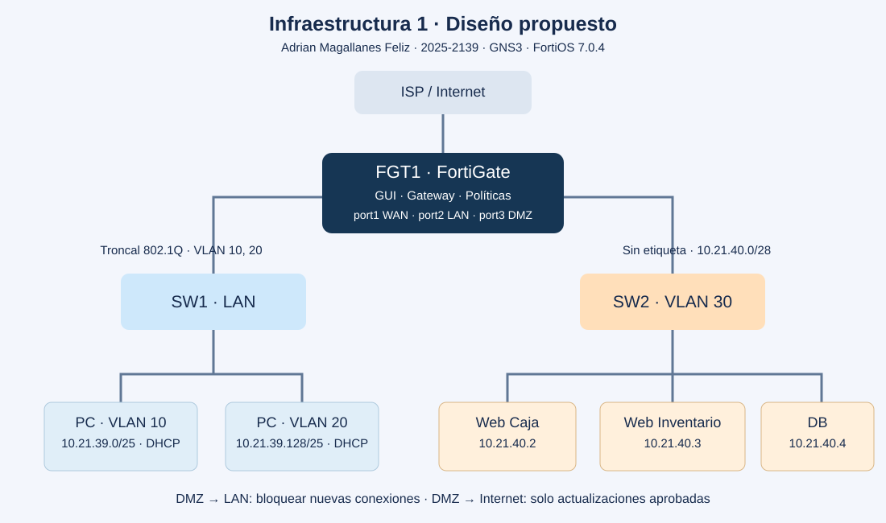

## Video demostrativo
[▶ Ver video demostrativo en YouTube](https://youtu.be/D0aCyLObEng)

# Práctica 3 · Infraestructura 1
## Seguridad de redes con FortiGate, DMZ y VLAN

**Estado:** diseño inicial; aún no configurado ni validado en equipos. Los documentos describen el comportamiento previsto, no resultados obtenidos.

| Dato | Valor |
|---|---|
| Asignatura | Seguridad de Redes · Semana 4 |
| Autor / matrícula | Adrian Magallanes Feliz · 2025-2139 |
| Plataforma / FortiOS | GNS3 · FortiOS 7.0.4 |
| Sistemas operativos | Ubuntu Desktop (clientes) y Ubuntu Server (servidores); versiones pendientes |
| Direccionamiento | Propuesto a partir de 2139: bloque 10.21.39.0 y siguiente bloque disponible |

## Propósito
Separar los servidores de Caja, Inventario y Base de Datos de las redes de usuarios; impedir conexiones iniciadas desde la DMZ hacia la LAN; limitar las actualizaciones a destinos autorizados; permitir SSH solamente desde VLAN 20; y mostrar un aviso de política infringida cuando VLAN 10 intente acceder al Inventario.

## Topología propuesta

Un FortiGate actúa como puerta de enlace. SW1 conecta usuarios en VLAN 10 y VLAN 20 por un enlace troncal. SW2 conecta los tres servidores en una DMZ separada físicamente de SW1. Los puertos son nombres propuestos que deben ajustarse al equipo real.

## Documentación
1. [Topología y direccionamiento](docs/01-topologia-direccionamiento.md)
2. [Matriz de políticas](docs/02-politicas-seguridad.md)
3. [Implementación por etapas y FortiGate por GUI](docs/03-implementacion.md)
4. [Pruebas y guion del video](docs/04-pruebas-video.md)
5. [Evidencias e imágenes](evidencias/README.md)
6. [Running-configs](configs/README.md)
7. [Scripts utilizados](scripts/README.md)
8. [Preparación del TXT de entrega](entrega/README.md)

## Avance verificable
- [x] Estructura documental inicial y diagrama de diseño.
- [x] Nombre, matrícula, GNS3 y versión de FortiOS registrados.
- [ ] Confirmar versiones Ubuntu, modelos de switch e IP sin conflictos.
- [ ] VLAN y seguridad básica en ambos switches.
- [ ] DMZ y DHCP configurados.
- [ ] Caja, Inventario y DB operativos.
- [ ] Políticas implementadas y comprobadas.
- [ ] Aviso de bloqueo visible desde VLAN 10.
- [ ] Actualización autorizada y navegación arbitraria bloqueada.
- [ ] Capturas reales, scripts y running-configs publicados.
- [ ] Video y TXT final.

Esta infraestructura tiene su propio repositorio y video. La Infraestructura 2 se entrega por separado.
